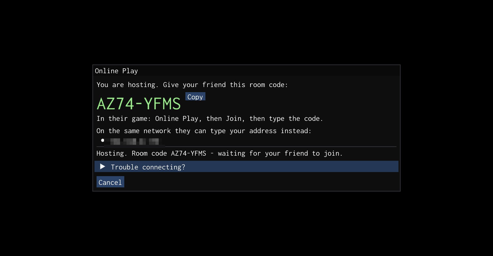
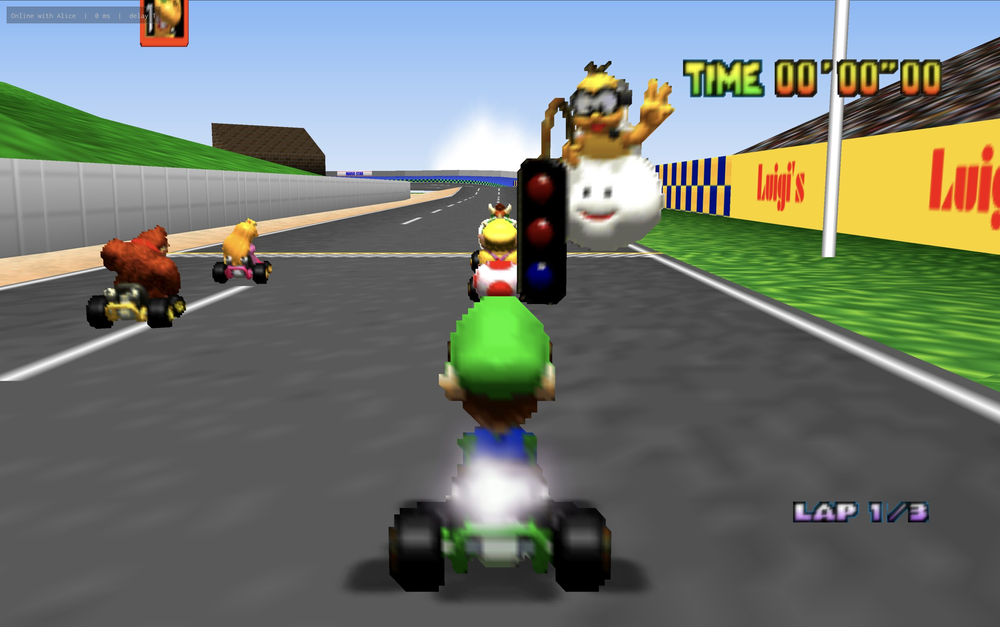
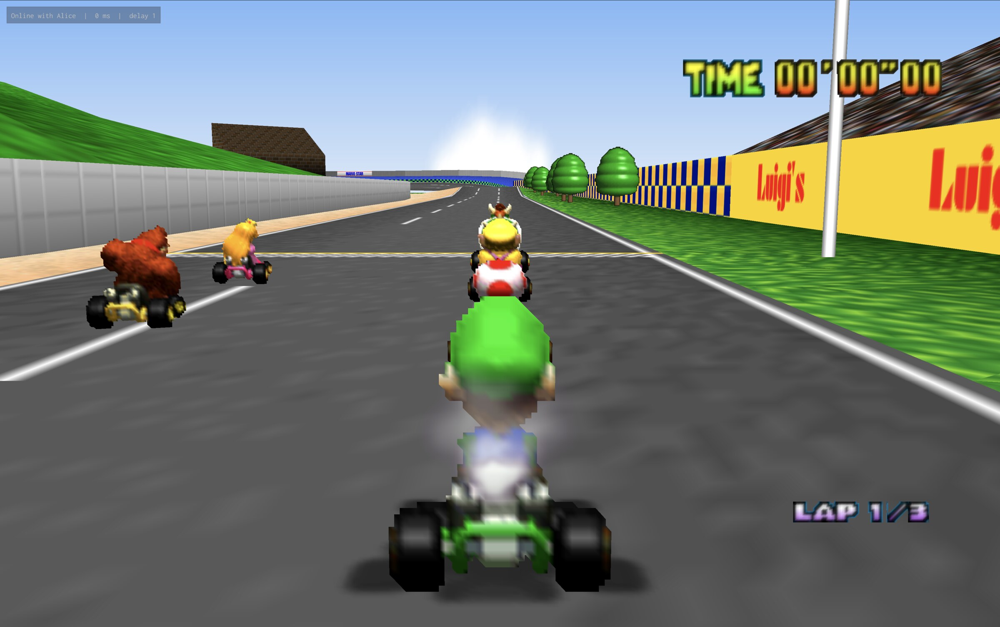

## Online play (this fork)

This is a fork of [HarbourMasters/SpaghettiKart](https://github.com/HarbourMasters/SpaghettiKart) that adds online play for two players on two computers. Each player sees their own kart full screen, the way a one-player game looks, while both machines run the same race frame by frame: same karts, same items, same everything. Grand Prix, VS and Battle all work. Everything below this section is upstream's README; all credit for the port itself goes to its maintainers.

### What it adds

- **Lockstep netcode.** Only controller input crosses the network (4 bytes per player per frame). The input delay is chosen from the measured round trip, inputs are sent redundantly so a lost packet does not stall the game, and a per-frame state hash warns if the two games ever diverge.
- **Room codes.** The host gets an 8-character code such as `K7QM-2XRD`; the other player types it in. The code is exchanged through a topic on the public [ntfy.sh](https://ntfy.sh) service, public STUN servers (Google, Cloudflare) find each side's public address, and UDP hole punching connects the two machines directly. There is no game server.
- **Fallbacks.** On the same network you can type the host's LAN address instead of a code. A copy-paste connection code works when ntfy.sh is unreachable. For networks that block direct connections there is a small UDP relay you can run yourself on any machine with a public UDP port (`tools/netplay/relay/relay.cpp`); enter its `host:port` under **Online → Play Online → Advanced: relay server**. No relay is configured by default.
- **Your own view.** Every machine simulates the full split-screen game, but the renderer stretches the local player's region over the whole window, and you hear your own camera's sound.
- **An overlay** showing who you are playing, the round trip, the input delay, pauses, waits and any out-of-sync warning.
- **Determinism fixes** that make two machines compute identical races: strict IEEE floating point and signed `char` (so a Mac and a Linux build of the same commit can play each other), zeroed uninitialised actor and object fields, a fixed-pattern heap during online sessions, and music cues that no longer cut the cameras.
- **A macOS 27 fix** for the Metal shader compile failure.

### Hosting and joining

Both players need a build of the same commit (the game refuses to connect different builds) and their own US Mario Kart 64 ROM; nothing from the ROM is in this repository.

1. **Host:** press **Esc**, go to **Online → Play Online**, type your name and click **Host a game**. The game restarts into the online lobby and shows a room code.
2. **Other player:** press **Esc**, go to **Online → Play Online**, type your name, enter the room code under **Join** and click **Join**. Connecting usually takes two or three seconds.
3. Both games then start together from power-on, like one console with two controllers. The host is player 1 and drives the menus: choose **2P GAME**, then Grand Prix, VS or Battle. Each player picks their character with their own controller.

The full guide, including what each error message means, is [docs/HOW-TO-PLAY-ONLINE.md](docs/HOW-TO-PLAY-ONLINE.md).

### Building

- Build the `netplay` branch exactly as upstream describes in [docs/BUILDING.md](docs/BUILDING.md). Clone with submodules: `git clone --recursive -b netplay https://github.com/gregoryjayuk/mk64-online.git`.
- The `libultraship` submodule points to a fork ([gregoryjayuk/libultraship](https://github.com/gregoryjayuk/libultraship), branch `mk64-online-netplay`) that adds the renderer's focus region, an in-memory save for online sessions, the Metal shader fix and an optional window snapshot for tests.
- The online build id is stamped at build time from the last commit that touched code, so both players should build the same commit from a clean tree.
- macOS: `tools/netplay/package-mac.sh` turns a Release build into a zip another Mac can open (no Nintendo data inside). Linux: `tools/netplay/linux/` holds a launcher for a packaged build.
- `tools/netplay/localtest.py` runs two copies of the game against each other on one machine, driven by a test bot, and compares their per-frame state hashes.

Tested between two copies on one Mac (Apple Silicon, Metal) and between a Mac and an x86-64 Linux PC (gcc, OpenGL) through races, battles and results with no desyncs. Windows is not built or tested yet. Two players only. Why it is built this way: [docs/DECISIONS.md](docs/DECISIONS.md); known issues: [docs/ISSUES.md](docs/ISSUES.md); ideas: [docs/IMPROVEMENTS.md](docs/IMPROVEMENTS.md); history: [docs/CHANGELOG.md](docs/CHANGELOG.md). Licensing follows upstream SpaghettiKart.

---

## Website & Discord

Official Website: https://www.harbourmasters.org/

If you're having any trouble after reading through this `README`, feel free ask for help in the SpaghettiKart Support text channels. Please keep in mind that we do not condone piracy.

# Quick Start

SpaghettiKart does not include any copyrighted assets.  You are required to provide a supported copy of the game.

### 1. Verify your ROM dump

The US ROM is the only supported version. You can verify you have dumped a supported copy of the game by using the SHA-1 File Checksum Online at <https://www.romhacking.net/hash/>. The hash for a US ROM is SHA-1: 579C48E211AE952530FFC8738709F078D5DD215E.

### 2. Verify your ROM is in .z64 format

Your ROM needs to be in .z64 format. If it's in .n64 format, use the following to convert it to a .z64: <https://hack64.net/tools/swapper.php>

### 2. Download SpaghettiKart from [Releases](https://github.com/HarbourMasters/SpaghettiKart/releases)

### 3. Generating the O2R from the ROM

#### Windows

* Extract every file from the zip into a folder of your choosing.
* Run "Spaghettify.exe" and select your US ROM.

#### Linux

* Extract every file from the zip into a folder of your choosing.
* Ensure `zenity` or `kdialog` package is installed.
* Run "spaghetti.appimage" and select your US ROM. You may have to chmod +x the appimage via terminal.

#### Nintendo Switch

* Run one of the PC releases to generate an `mk64.o2r` file. After launching the game on PC, you will be able to find these files in the same directory as `Spaghettify.exe` or `spaghetti.appimage`.
* Copy the files to your sd card

### 4. Play

* Launch `Spaghettify.exe`
Congratulations, you are now sailing with SpaghettiKart! Have fun!

# Configuration

### Default controls configuration

| N64 | A | B | L | R | Z | Start | Analogue stick | C buttons | D-Pad |
| - | - | - | - | - | - | - | - | - | - |
| Keyboard | Shift | Ctrl | Q | Space | Z | Enter | Arrow keys | TGFH (↑ ↓ ← →) | Num 8 2 4 6 |
| SDL Gamepad | A | X | LB | RB | LT | Start | L-Stick | R-Stick Up, B, Y, R-Stick Right (↑ ↓ ← →) | D-Pad |

### Other shortcuts

| Keys | Action |
| - | - |
| F11 | Fullscreen |
| Tab | Toggle Alternate assets |
| Ctrl+R | Reset |
| Esc | Settings |

### Graphics Backends

Currently, there are three rendering APIs supported: DirectX11 (Windows), OpenGL (all platforms), and Metal (macOS). You can change which API to use in the `Settings` menu of the menubar, which requires a restart.  If you're having an issue with crashing, you can change the API in the `spaghettify.cfg.json` file by finding the line `"Backend":{`... and changing the `id` value to `3` and set the `Name` to `OpenGL`. `DirectX 11` with id `2` is the default on Windows. `Metal` with id `4` is the default on macOS.

# Modding

Custom assets are packed in `.o2r` or stored `.zip` files. To use custom assets, place them in the `mods` folder.

There is an official [gamebanana page](https://gamebanana.com/games/22970).

If you're interested in creating and/or packing your own custom asset `.o2r` files, check out the [documentation page](https://harbourmasters.github.io/SpaghettiKart/).

**Note that .otr archives are not supported in SpaghettiKart!**

# Development

### Building

If you want to manually compile SpaghettiKart, please consult the [building instructions](https://github.com/HarbourMasters/SpaghettiKart/blob/main/docs/BUILDING.md).

### Playtesting (nightly)

If you want to playtest a continuous integration build, you can find them at the links below. Keep in mind that these are for playtesting only, and you will likely encounter bugs and possibly crashes.

* [Windows 64 bit](https://nightly.link/HarbourMasters/SpaghettiKart/workflows/main/main/spaghetti-windows-x64.zip?status=completed)
* [Windows 32 bit](https://nightly.link/HarbourMasters/SpaghettiKart/workflows/main/main/spaghetti-windows-Win32.zip?status=completed)
* [Linux 64 bit](https://nightly.link/HarbourMasters/SpaghettiKart/workflows/main/main/spaghetti-linux-x64.zip?status=completed)
* [Linux 32 bit](https://nightly.link/HarbourMasters/SpaghettiKart/workflows/main/main/spaghetti-linux-x86.zip?status=completed)
* [macOS-arm64](https://nightly.link/HarbourMasters/SpaghettiKart/workflows/main/main/spaghetti-mac-arm64.zip?status=completed)
* [macOS-intel](https://nightly.link/HarbourMasters/SpaghettiKart/workflows/main/main/spaghetti-mac-intel-x64.zip?status=completed)
* [Switch](https://nightly.link/HarbourMasters/SpaghettiKart/workflows/main/main/Spaghettify-switch.zip?status=completed)

Maintainers: [MegaMech](https://www.github.com/MegaMech), [Coco](https://www.github.com/coco875), [Kirito](https://github.com/KiritoDv)

<a href="https://github.com/Kenix3/libultraship/">
  <picture>
    <source media="(prefers-color-scheme: dark)" srcset="./docs/poweredbylus.darkmode.png">
    
  </picture>
</a>
